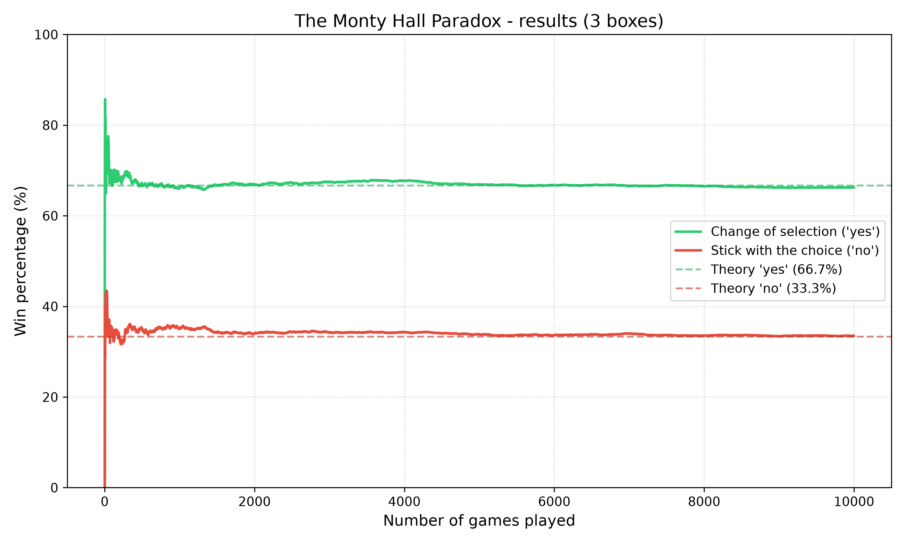

# Monty Hall Paradox Simulator


A Python CLI simulator demonstrating the Monty Hall probability paradox across a customizable number of boxes and simulation runs, complete with Matplotlib convergence visualization.

## Features

- **Interactive CLI Mode (`simulation.py`):** Play the classic Monty Hall game manually in the terminal.
- **Automated Monte Carlo Simulation (`automatic_game.py`):** Compare *"switch"* (`yes`) vs. *"stay"* (`no`) strategies over thousands of iterations.
- **Customizable Parameters:** Adjust the number of simulated games (`-g` / `--games`) and boxes (`-b` / `--boxes`, minimum 3).
- **Convergence Plotting (`--plot`):** Generates a PNG chart comparing empirical win rates against theoretical probabilities.
- **Strict Type Checking & Unit Tests:** Fully annotated for `mypy --strict` and covered by `pytest`.

## Project Structure

```text
├── automatic_game.py      # CLI entry point for automated simulations
├── cli.py                 # Interactive terminal version of the game 
├── logic.py               # Core game mechanics and probability logic
├── simulation.py          # Simulation runner and strategy evaluation
├── visualization.py       # Matplotlib convergence chart generation
├── tests/                 # Unit tests (pytest)
├── pytest.ini             # Pytest configuration
└── requirements.txt       # Project dependencies
```
## Installation
1. Clone the repository:
```
git clone [https://github.com/](https://github.com/)HeyRoseHaze/monty-hall-simulation.git
cd monty-hall-simulation
```
2. Create and activate a virtual environment:
```
python -m venv .venv
# Windows:
.venv\Scripts\activate
# Linux/macOS:
source .venv/bin/activate
```
3. Install dependencies:
```
pip install -r requirements.txt
```
## Usage
Run an automated simulation (default: 10,000 games, 3 boxes):
```
python automatic_game.py
```
Run with custom parameters and save a convergence plot:
```
python automatic_game.py -g 5000 -b 10 --plot
```
Play the interactive game in the terminal:
```
python simulation.py
```
## Example Output
```
Number of boxes in the game: 3

Results for decision: 'yes' (Played: 10000)
Wins: 6621 (66.21%)
Losses: 3379

Results for decision: 'no' (Played: 10000)
Wins: 3343 (33.43%)
Losses: 6657
```


## Development & Testing
Run the test suite:
```
pytest -v
```
Run static type checking:
```
mypy --strict .
```